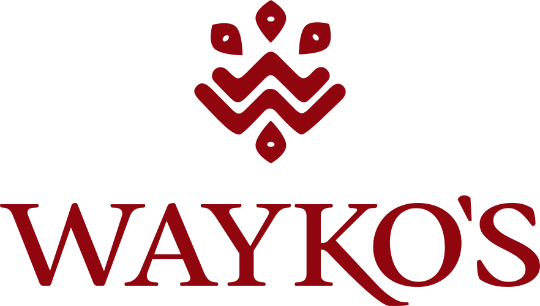

<p align="center">
  
</p>

<h1 align="center">Wayko's Restaurante Rural</h1>

<p align="center">
  <strong>Sitio web oficial de Wayko's Restaurante Rural</strong><br>
  Comida de calidad en un lugar de desconexión, con granja propia, en La Esperanza, Ibarra, Ecuador.
</p>

<p align="center">
  
  
  
  
  
</p>

<p align="center">
  <a href="#-características">Características</a> •
  <a href="#-stack-tecnológico">Stack Tecnológico</a> •
  <a href="#-estructura-del-proyecto">Estructura</a> •
  <a href="#-desarrollo-local">Desarrollo Local</a> •
  <a href="#-despliegue-en-cloudflare">Despliegue</a> •
  <a href="#-contacto-y-redes">Contacto</a>
</p>

---

## 🌟 Características

- **Diseño Gastronómico de Alta Fidelidad**: Desarrollado a partir de los diseños oficiales en Figma con estética rústica elegante, tipografías *Playfair Display* y *Montserrat* (alojadas en el propio sitio con el Fonts API de Astro) y colores de marca (`#90050e`, `#e5a93c`).
- **Modo Oscuro / Claro**: Toggle con persistencia en `localStorage` y script anti-parpadeo (*anti-FOUC*) en el layout principal.
- **Internacionalización (i18n)**:
  - Español por defecto: `/`
  - Inglés: `/en/`
  - Selector de idioma en el header que conserva la posición de scroll.
- **Secciones**:
  - **Hero**: Fotografía a pantalla completa con llamadas a la acción.
  - **Especialidades de la Casa**: Tarjetas de cordero al grill, maduro con queso, lasaña y pizzas, con enlace a la carta completa en `/menu.pdf`.
  - **Reservas por WhatsApp**: Formulario que genera el mensaje de reserva en el idioma de la página. Propone el próximo día de atención y avisa si la fecha elegida cae en un día que normalmente no abrimos.
  - **Nuestro Equipo** y **Nosotros & Ubicación**: Mapa de Google Maps y accesos directos a **Google Maps** y **Waze**.
- **Imágenes responsivas**: Fotos en `src/assets/fotos/` (WebP, máx. 2400 px), generadas con `pnpm photos` desde los originales y servidas con `srcset` por `astro:assets`.
- **La granja**: sección en la portada y página propia en `/granja` (`/en/farm`).
- **SEO local**: JSON-LD de tipo `Restaurant`, `hreflang`, Open Graph (`public/og-image.jpg`, 1200×630) y sitemap generado con `@astrojs/sitemap`.

---

## 🛠️ Stack Tecnológico

| Herramienta | Propósito |
| :--- | :--- |
| [**Astro 6**](https://astro.build/) | Generación estática (SSG), optimización de imágenes y fuentes. |
| [**Tailwind CSS v4**](https://tailwindcss.com/) | Estilos utilitarios con variables CSS y tema oscuro. |
| [**Sharp**](https://sharp.pixelplumbing.com/) | Procesamiento de imágenes en el build. |
| [**Cloudflare Workers (static assets)**](https://developers.cloudflare.com/workers/static-assets/) | Alojamiento del sitio estático (`wrangler.jsonc`). |
| [**TypeScript**](https://www.typescriptlang.org/) | Tipado de la configuración i18n y datos del sitio (`astro check`). |

---

## 📂 Estructura del Proyecto

```text
waykosrestaurante-web/
├── .github/workflows/ci.yml       # CI: astro check + build en cada PR
├── public/
│   ├── _headers                   # Cabeceras de caché y seguridad
│   ├── favicon*.png / .ico / .svg # Favicons de la marca
│   ├── menu.pdf                   # Carta oficial (reemplazar este archivo para actualizarla)
│   ├── og-image.jpg               # Imagen para redes sociales (1200×630)
│   ├── robots.txt
│   └── waykos*.svg                # Logotipos
├── src/
│   ├── assets/fotos/              # Fotografías WebP (generadas por scripts/photos.mjs)
│   ├── components/                # About, Footer, Hero, LanguagePicker, Navbar,
│   │                              # Reservation, Specialties, Team, ThemeToggle, WaykosLogo
│   ├── data/
│   │   └── site.ts                # Datos del negocio: URL, WhatsApp, redes, mapa, horario
│   ├── i18n/
│   │   ├── translations.ts        # Textos ES / EN
│   │   └── utils.ts               # Helpers de traducción
│   ├── layouts/Layout.astro       # HTML base, SEO, JSON-LD y anti-FOUC
│   ├── pages/
│   │   ├── index.astro            # Español (/)
│   │   └── en/index.astro         # Inglés (/en/)
│   └── styles/global.css          # Tailwind v4, tokens de color y normalización iOS
├── astro.config.mjs               # Astro: sitemap, fuentes e i18n
└── wrangler.jsonc                 # Despliegue en Cloudflare
```

---

## 🚀 Desarrollo Local

### Prerrequisitos
- **Node.js** 22.12 o superior
- **pnpm** (versión fijada en `packageManager`)

### Comandos

```bash
pnpm install     # instalar dependencias
pnpm dev         # servidor de desarrollo en http://localhost:4321
pnpm check       # verificación de tipos (astro check)
pnpm build       # compilar a dist/
pnpm preview     # previsualizar la compilación
pnpm run deploy  # compilar y desplegar con wrangler
pnpm photos      # reprocesar fotos desde waykos-design/ (ver CLAUDE.md)
```

Variables de entorno opcionales: copia `.env.example` a `.env`.

### Actualizar la carta
Reemplaza `public/menu.pdf` por el nuevo PDF y, si cambian precios de las especialidades, actualízalos en `src/components/Specialties.astro`.

---

## ☁️ Despliegue en Cloudflare

El sitio es 100 % estático y se publica como *static assets* de Cloudflare Workers:

- **Build command**: `pnpm build`
- **Deploy command**: `npx wrangler deploy` (lee `wrangler.jsonc`, que publica `./dist`)
- **Cabeceras**: `public/_headers` (caché inmutable para `/_astro/*`, HSTS y cabeceras de seguridad).
- **Variables de entorno** (opcional): `PUBLIC_WHATSAPP_NUMBER`.

---

## 📱 Contacto y Redes

- **Ubicación**: La Esperanza, Ibarra, Imbabura, Ecuador
- **WhatsApp Reservas**: [+593 96 914 3757](https://wa.me/593969143757)
- **Instagram**: [@waykosrestaurante](https://www.instagram.com/waykosrestaurante/)
- **Facebook**: [@waykosrestaurante](https://www.facebook.com/waykosrestaurante)

---

<p align="center">
  <sub>Desarrollado con dedicación para <strong>Wayko's Restaurante Rural</strong>. Todos los derechos reservados © 2026.</sub>
</p>
